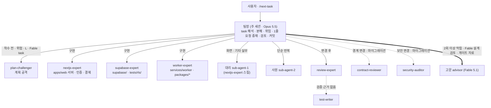

# 멀티에이전트 — 팀으로 개발하기

> Claude Code 세션 하나가 **팀장**이 되어, 작업을 나눠 팀원 에이전트에게 맡기고 결과를 검토합니다.
> 에이전트 정의는 [`.claude/agents/`](../.claude/agents/README.md), 분야 규약은 `.claude/skills/`, 명령은 `.claude/commands/`에 있습니다.
> 출처: DevOps0906/tablet-kiosk-core 멀티에이전트 구성(커밋 15f8727, 원본 `docs/11-multi-agent.md`)을 GlobalCommerce에 맞게 옮겼습니다.
> 그 원본은 [MultiAgent-Service-Fullstack-Tree-Framwork](https://github.com/DevOps0906/MultiAgent-Service-Fullstack-Tree-Framwork)에서 필요한 부분만 옮긴 것입니다 (7장).

함께 읽을 문서: 루트 [`CLAUDE.md`](../CLAUDE.md)(팀장 운영 규칙), [`products/CLAUDE.md`](../products/CLAUDE.md)(제품 절대 규칙 · 소유 경계),
[`products/00_DECISIONS.md`](../products/00_DECISIONS.md)(결정 · ID 정본), [`products/06_AGENT_PLAN.md`](../products/06_AGENT_PLAN.md)(작업 · 소유 경로 · 담당 정본),
[`globalcommerce_develop.md`](globalcommerce_develop.md)(개발 안내서), [`tasks/README.md`](../tasks/README.md)(진행 현황 · 기록 형식).

역할 나눔: 이 문서는 **팀이 어떻게 일하나**(구조 · 위임 · 검증 · 고문 · 비용)를 정하고, **어떤 작업을 누가 어떤 모델로 하나**는 06장 2절 "담당" 열이 정합니다.

## 1. 구조

- 팀원은 서로를 부르지 않습니다. **모든 호출은 팀장이 중개**합니다 (깊이 1).
- 검증 에이전트는 코드를 고치지 않습니다. 고치는 일은 구현 담당에게 돌려보냅니다.
- 리뷰어끼리는 서로의 결과를 보지 않고 각자 판단합니다 (형제 호출).
- 작업은 **소유 경로** 안에서만 고칩니다. 밖의 변경은 1줄 요청(`[REQUEST]`)으로 소유 작업에 넘깁니다 (06장 1절 · 2.1절).

## 2. 팀 구성

| 분류 | 에이전트 | 모델 (frontmatter) | 쓰기 | 맡는 일 |
|---|---|---|---|---|
| 고문 | `advisor` | `claude-fable-5-1` | 없음 | 2회 이상 막힌 문제 진단, Fable 작업 착수 전 설계 검토, 게이트 G1 · R1 · G2 판정 자료 검토, 열린 결정 선택지 정리 |
| 팀장 | (주 세션) | `claude-opus-5-5` | 전체 | 배정 · 위임 · 1줄 요청 중재 · 검증 판정 · 커밋 |
| 대리 | `sub-agent-1` | `claude-sonnet-5-5` | 있음 | `apps/web` 화면 · 컴포넌트 · 셸(nextjs-expert 스킬), 분야 밖 판단 필요 실무, 문서, 리뷰 지적 반영 |
| 사원 | `sub-agent-2` | `claude-haiku-5-5` | 있음 | 탐색, 캔버스 · 스펙 값 추출, 문구 상수, 점검 스크립트 · 체크리스트, 시드 · task 파일 초안, 형식 점검 |
| 분야 | `nextjs-expert` | `claude-sonnet-5-5` | 있음 | `apps/web` 모노레포 골격 · Route Handler · 인증 · 결제 · 자격증명 저장 · 서버 컴포넌트 · 캔버스 · 랜딩 |
| 분야 | `supabase-expert` | `claude-sonnet-5-5` | 있음 | `supabase/` 마이그레이션 · RLS · RPC · 트리거 · seed, `tests/rls/`, 검색 RPC |
| 분야 | `worker-expert` | `claude-sonnet-5-5` | 있음 | `services/worker`, `packages/*`(domain · compliance · ai · net · sourcing · markets · render) |
| 검증 | `plan-challenger` | `claude-opus-5-5` | 없음 | 착수 전 계획 공격 |
| 검증 | `review-expert` | `claude-sonnet-5-5` | 없음 | 변경 후 리뷰 · 추적성 |
| 검증 | `contract-reviewer` | `claude-sonnet-5-5` | 없음 | 경계 계약 대조 |
| 검증 | `security-auditor` | `claude-sonnet-5-5` | 없음 | 보안 심층 감사, 보안 점검 작업(GC-06-034) |
| 검증 | `test-writer` | `claude-sonnet-5-5` | 테스트만 | 테스트 작성 · 실행, E2E 작업(GC-06-033) |

직급 구조는 `products/00_DECISIONS.md` 5.6 의 모델 배치(고문 Fable · 주 Opus · 대리 Sonnet · 사원 Haiku)와 같습니다.

## 3. 누구에게 맡기나

### 3.1 구현 — 기본 영역

06장 2절 "담당" 열이 작업별 정본입니다. 열이 비었거나 작업 안의 하위 지시를 나눌 때 아래 기본 영역을 씁니다.

| 영역 | 기본 담당 |
|---|---|
| `apps/web` 화면 · 컴포넌트 · 셸 · 화면 문구 연결 | 대리 (nextjs-expert 스킬) |
| `apps/web` 모노레포 골격 · Route Handler · `proxy.ts` · 인증 · 결제 · 웹훅 · `lib/credentials/` · 슈퍼 어드민 · 노드 캔버스 · 랜딩 | nextjs-expert |
| `supabase/` 마이그레이션 · RLS · RPC · 트리거 · seed · 타입 생성, `tests/rls/` | supabase-expert |
| `services/worker`, `packages/*` | worker-expert |
| 루트 `tests/e2e/` 핵심 흐름, 수용 기준 테스트 보강 | test-writer |
| 문서(`products/` · `develop/`) 수정, 여러 영역에 걸친 작은 수정, 리뷰 지적 반영 | 대리 |
| 캔버스 · 스펙 값 추출, 문구 상수(`apps/web/lib/copy/<화면>.ts`), `.env.example` 이름, 체크리스트, 파일 탐색 | 사원 |
| 한 줄 수정 등 위임 비용이 더 큰 일 | 팀장 직접 |

**대리 vs 사원**: 규칙을 한 문장으로 줄 수 있고 결과를 기계적으로 확인할 수 있으면 사원, 기존 동작이 바뀌면 대리.

### 3.2 검증 — 어떤 리뷰를 붙이나

06장 2절 "담당" 열의 `/` 뒤가 그 작업의 검증 에이전트입니다. review-expert 는 모든 작업에 공통으로 붙습니다 (06장 1.1절). 아래는 그 기준과, 06장에 없을 때 쓰는 기본 규칙입니다.

| 상황 | 붙이는 에이전트 | 시점 |
|---|---|---|
| 모든 구현 task | review-expert | 변경 후 |
| 규모 L · Fable 작업, 결제(Toss) · 크레딧 차감 · 권한 · RLS · DB 스키마 · 마켓 API 키 암호화 · 마켓 업로드 · AI 키 · 프롬프트(금지어 · 표시광고) · SNS 토큰 · 잡 큐 · 실행 엔진 | + plan-challenger | 착수 전 1회 |
| API · DB · 잡 계약(00장 5.3~5.5, 04 · 05장)을 만들거나 쓰는 변경, web ↔ DB ↔ worker, packages ↔ apps, 외부 마켓 · SNS · AI · 결제 API 경계 | + contract-reviewer | 변경 후 (형제) |
| 인증 · 결제 · 크레딧 · 키 · 토큰 · RLS · 외부 fetch · 파일 업로드 · AI 프롬프트 · 개인정보 | + security-auditor | 변경 후 (형제) |
| 모든 마이그레이션 | + contract-reviewer · security-auditor (06장 1절) | 변경 후 (형제) |
| 수용 기준에 자동 테스트가 있음, 리뷰가 "검증 근거 없음" | test-writer → review-expert 재실행 | 후행 |

### 3.3 06장 "담당" 열 읽는 법 · 모델 지정

"담당" 열은 `<모델> · <에이전트> / <검증 에이전트>` 형식입니다 (예: `Fable · supabase-expert / plan-challenger, contract-reviewer, security-auditor`).

| 06장 모델 | 팀장이 하는 일 |
|---|---|
| Fable | 팀장이 설계 → **고문 설계 검토 1회**(4장 5번) → plan-challenger → 담당 에이전트 구현. 호출 도구가 모델 지정을 지원하면 Fable 로 부르고, 아니면 frontmatter 모델로 부른다 |
| Opus | 팀장이 설계 → 담당 에이전트 구현. 가능하면 Opus 로 지정해 부른다 |
| Sonnet | 담당 에이전트(분야 또는 대리)를 frontmatter 모델 그대로 부른다 |
| Haiku | 사원. 수용 기준을 규칙으로 넘기고, 모호하면 대리로 바꾼다 |

- 모델 지정은 06장 1절의 "제안"입니다. 지정하지 못했으면 `[DELEGATE]` 로그에 실제 모델을 적습니다. frontmatter 는 바꾸지 않습니다.
- 작업 안에서 다른 영역 변경이 필요하면 하위 지시로 나눕니다 (예: 화면 작업의 문구 상수는 사원, 마켓 계정 작업의 검증 함수는 027 · 028 어댑터 사용). 소유 경로 밖이면 `[REQUEST]`입니다.
- `develop/globalcommerce_develop.md` 6.3 표는 작업별 배치 제안입니다. 06장과 다르면 06장이 이깁니다.

## 4. 고문 호출 규칙

1. 팀장이 원인을 다시 분석하고 지시를 고쳐 써도 **같은 문제로 2회 이상 실패**했을 때 부릅니다.
2. 문제 상황, 시도한 방법과 실패 원인, 관련 파일 경로, 결정할 질문을 정리해 넘깁니다.
3. 고문의 권고는 참고 의견입니다. 최종 결정과 실행 지시는 팀장이 하고, task 로그에 `[DECISION]`으로 남깁니다.
4. 가장 비싼 모델이므로 일상 작업 · 일반 착수 전 검토(plan-challenger 몫)에는 부르지 않습니다.
5. **정해진 예외** (06장 1.1절):
   - 06장에서 Fable 배치인 작업(DB · RLS 002 · 003, 인증 006 · 036 · 044, 크레딧 · 결제 008 · 009 · 010, 키 · 권한 011 · 013, 보안 점검 034)의 **착수 전 설계 검토 1회**. 그 뒤의 호출은 1번 규칙을 따릅니다.
   - 게이트 G1 · R1 출시 · G2 의 **판정 자료 검토**. 판정은 대표님이 하고 `[DECISION]`으로 남깁니다. 고문 · 팀장이 게이트를 넘기지 않습니다.
   - 열린 결정(O-##) **선택지 정리**. 결정은 대표님.

## 5. 위임 규칙 (팀장)

1. 위임 전 작업을 명확한 단위로 나누고, 범위 · **소유 경로** · 대상 파일 · 완료 기준(06장 수용 기준) · task 의 "안 할 것"을 지시에 넣습니다.
2. 지시에는 **문서 내용을 붙여 넣지 말고 경로만** 줍니다 (예: `products/00_DECISIONS.md` 5.4, `products/04_API.md` 4장 `upload.coupang`). 팀원이 직접 읽습니다.
3. 사원에게는 규칙과 예시를 함께 줍니다. 규칙이 모호하면 대리에게 넘깁니다.
4. 팀원이 "팀장 확인 필요"로 보고한 사항은 팀장이 결정하고 task 로그에 `[DECISION]`으로 남깁니다. 설계와 다르게 가야 하면 루트 `CLAUDE.md` 3장 5번대로 문서부터 고칩니다.
   확정 결정(GC-D-##)을 바꿔야 하면 사용자 승인 후 `00_DECISIONS.md` 변경 이력에 남깁니다.
5. 팀원이 보고한 1줄 요청은 요청 작업 로그에 `[REQUEST]`로 옮기고, 소유 작업이 진행 중이면 그 담당에게, 끝났으면 팀장이 판단해 소유 작업을 다시 열거나 새 작업으로 올립니다. 코어 부족(`[REQUEST] core`)은 팀장이 판단합니다.
6. 같은 문제로 2회 이상 막히면 팀장이 지시를 다시 쓰고, 사원이 막힌 일은 대리에게 넘깁니다. 그래도 안 되면 고문.
7. 팀원은 commit · push 하지 않습니다. 커밋은 팀장만 합니다.
8. 영역 둘 이상에 걸친 작업은 보통 DB(supabase-expert) → 공유 패키지 · 워커(worker-expert) → 서버 · 화면(nextjs-expert · 대리) 순서로 위임하고, 앞 단계 결과를 받은 뒤 다음 지시를 씁니다.

## 6. 비용 · 토큰 줄이기

| 방법 | 내용 |
|---|---|
| 탐색은 사원에게 | 여러 파일 · 디자인 캔버스를 훑는 일을 Haiku 에게 맡기고 결론만 받습니다 |
| 문서는 필요한 장만 | task 참고 문서를 통째로 읽지 않습니다. 지시에도 장 · 절 번호까지 적습니다 |
| 검증은 필요한 만큼 | 06장 "담당" 열과 3.2 표에 해당할 때만 붙입니다. 같은 리뷰를 반복하지 않습니다 (실패 시만 재실행) |
| task 하나 끝나면 `/clear` | 다음 task 는 새 맥락에서 시작합니다. 진행 상태는 `tasks/README.md` · task 로그 · 커밋에 남아 있습니다 |
| 고문은 정해진 때만 | Fable 은 Opus 의 약 2.5배 비용입니다. 4장 1번과 5번 예외 외에는 부르지 않습니다 |

## 7. 원본에서 옮긴 것 · 바꾼 것

| tablet-kiosk-core 구성 | GlobalCommerce | 이유 |
|---|---|---|
| 직급형 구조(`advisor` · `sub-agent-1` · `sub-agent-2` · `settings.json`) | ✅ 그대로. 고문 예외(Fable 작업 설계 검토 · 게이트 자료 · 열린 결정)만 추가 | 사용자 확정 직급 구조, 06장 1.1절 |
| 운영 원칙 4원칙(루트 `CLAUDE.md` 8장) | ✅ 루트 `CLAUDE.md` 6장 | 모든 작업에 적용 |
| 검증 에이전트 5종 | ✅ 결제(Toss) · 크레딧 · RLS · 마켓 키 · 잡 큐 · 금지어 기준으로 재작성 | 결제 · 자격증명 · 표시광고를 다루는 제품 |
| `nextjs-expert`(`apps/admin` 사장님 대시보드 전체) | ✅ `apps/web` 서버 · 인증 · 결제 중심. 화면은 대리가 같은 스킬로 | 06장 1.1절 소유 나눔 |
| `supabase-expert`(스키마 `kiosk`, Edge Function) | ✅ `public` 모놀리스 · 코어 lite · `gc_` RPC · `tests/rls/` | `00_DECISIONS.md` 2절, 04 · 05장 |
| `flutter-expert` + 스킬 | ❌ → ➕ `worker-expert` + 스킬 | Flutter 앱 · 기기 연동이 없음. 위험 지점은 잡 워커 · 외부 API 어댑터 · 렌더 |
| `contract-reviewer` 계약 카탈로그(앱 ↔ DB ↔ 대시보드, 공통 ↔ 업종, 앱 ↔ 기기) | ✅ web ↔ DB ↔ worker, packages ↔ apps, 앱 ↔ 외부 마켓 · SNS · AI · 결제 | 경계가 바뀜 |
| `/check` · `/next-task` · `/agent-check` | ✅ pnpm 모노레포 · SQL 정적 점검 · 금지 패턴 grep · GC-06 작업 체계로 바꿈 | |
| `/sync-design`(업종 설계 저장소 ↔ Flutter 화면) | ✅ 디자인 캔버스 · 토큰 표 ↔ `apps/web` · `tokens.css` | 설계가 이 저장소 안에 있음 |
| `tasks/task-XXX.md` + README 표 | ✅ `tasks/task-###.md`(GC-06-### 번호, 착수 시 `TEMPLATE.md`로 생성) + 진행 현황 표 + 로그 절(`[DECISION]` · `[REQUEST]` 등) | 작업 정본은 06장 |
| task 별 기본 배치 표(원본 `docs/11` 3.3) | ❌ → 06장 2절 "담당" 열 읽는 법(3.3)으로 대체 | 작업별 배치 정본이 06장에 이미 있음 |
| 업종 설계 저장소 `--add-dir` | ❌ | 기획 · 디자인이 `products/` · `docs/`에 있음 |
| 결제 단말 · 프린터 · 쿠폰 · 업종 모듈 · 가짜 기기 규칙 | ❌ | 도메인이 다름. 대응 규칙은 Toss · 크레딧 · 마켓 업로드 · 가짜 어댑터 |
| `NOTICE` 파일 | ❌ (출처를 루트 `CLAUDE.md` 6장에 직접 적음) | 이식 범위 밖 |

원본 프레임워크에서 tablet-kiosk-core 가 이미 뺀 것(워커 풀 · 승인 게이트 스크립트 · task 폴더 · 위키 · KNOT · 디자인 스킬 · `init-project.sh`)은 여기서도 넣지 않았습니다.
산출물 체계는 `develop/docs/file/_index.md`(DOC-<단계>-###, `00_DECISIONS.md` 5절)가 따로 정합니다.

원본 구성이 바뀌어 다시 반영하려면 이 표를 기준으로 ✅ 항목만 비교합니다.
