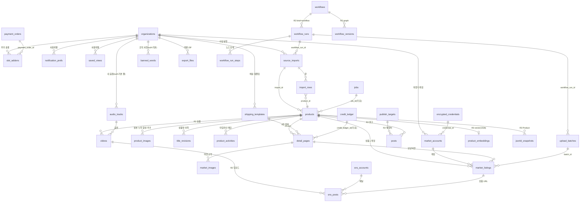

# 05 데이터 모델: GlobalCommerce

작성일 2026-10-25. 결정 정본은 `products/00_DECISIONS.md`(00장, 특히 5.3 테이블 이름, 5.4 잡 타입, 5.5 오류 코드). 벤치마크는 platform-docs `products/nomad-commerce/05_DATA_MODEL.md`와 그 `supabase/monolith/`. 정본 SQL은 이 저장소 `products/supabase/monolith/`의 세 파일이고, 이 문서와 SQL이 다르면 SQL이 이긴다(이 문서를 고친다). `01_PRD.md` 4.4절이 넘긴 `plans.features` 키 이름의 정본은 이 장과 `seed.sql`이다.

| 파일 | 줄 수 | 내용 |
|---|---|---|
| `supabase/monolith/0001_core_lite.sql` | 2,571 | 코어 lite(platform-docs `MONOLITH_CORE_LITE.sql` 절 단위 복사, 9절) |
| `supabase/monolith/0002_globalcommerce_domain.sql` | 2,147 | 도메인 31개 표(R1 22 + R2 7 + R3 2), 헬퍼·트리거·RPC 함수 28개, RLS, Realtime |
| `supabase/monolith/seed.sql` | 85 | apps 1행, 플랜 4, 크레딧팩 3, 기본 금지어 14, 기본 음원 자리 표시 5 |

## 1. 개요와 ERD

모든 표는 `public` 스키마(GC-D-02 모놀리스). 테넌트 표는 `org_id → organizations(id) on delete cascade`, 자식은 `(org_id, <부모>_id)` 복합 FK로 부모의 `unique (org_id, id)`를 참조해 다른 조직 행을 가리킬 수 없다. 선택 참조는 PG15 `on delete set null (<col>)`로 `org_id`를 지우지 않는다. 조직 없는 표는 전역 캐시 3개(`fx_rates`, `trend_keywords`, `season_picks`)뿐이고, `banned_words`·`audio_tracks`는 `org_id null` 행이 기본 사전·기본 음원 풀이다.

전역(조직 없음, 로그인 사용자 읽기): `fx_rates`(한국수출입은행, GC-D-16), `trend_keywords`(네이버 데이터랩, GC-D-17), `season_picks`(4주 전 대비 증가율 상위).

## 2. 테이블

표준 컬럼: `id uuid`(이력·캐시는 bigint identity), `org_id`, `created_at`, UPDATE 표는 `updated_at` + `set_updated_at`, 사용자 쓰기 표는 `created_by`를 `gc_stamp_creator`가 `auth.uid()`로 고정. 비밀값 컬럼은 없다. 마켓 키·WordPress 비밀번호·SNS 토큰은 코어 `encrypted_credentials`(provider `coupang_wing`, `naver_commerce`, `wordpress`, `youtube`, `instagram`)에만 있고 도메인 표는 `credential_id`만 갖는다. "사용자 쓰기"가 "없음"인 표는 서버(service_role, RPC) 전용이며 `guard_privileged_write` 트리거로 이중 잠금한다.

### 2.1 설정 (R1)

| 테이블 | 컬럼 요약 | 제약 | 사용자 쓰기 | 화면 |
|---|---|---|---|---|
| `market_accounts` | market(쿠팡·스마트스토어 + R2 4개), label, credential_id, vendor_id, key_hint(끝 4자, 마스킹 표시용), status(active/expired/error/disabled), last_verified_at, expires_at, last_error | unique(org, market, label). 슬롯 트리거 GC003, 다른 조직·앱 자격증명 42501 | 없음 | S13 "연결됨/키 만료", S06 계정 열 |
| `slot_addons` | quantity(1~50), unit_price_krw(O-03 전 null), payment_order_id, status(pending/active/canceled/expired), period_start/end | 상태 전이 | 없음(owner/admin 읽기) | S14 추가 슬롯 3단계 |
| `shipping_templates` | name, template_type, auto_attach_overseas("해외 상품에 자동으로 붙이기"), notice_text(≤1000), dispatch_days, delivery_days_min/max, return_window_days, exchange_allowed, return_fee_krw, restriction_codes(법정 4코드), requires_customs_code, return_address, contact_phone, is_default | `return_window_days >= 7` CHECK + 트리거 GC006, "반품 불가" 류 문구 GC006, 기본 1개 | owner/admin(컬럼 GRANT) | S13 배송, S05 4번 블록 |
| `audio_tracks` | org_id(null=기본 풀), title, source(upload/suno/default), mood_tags(≤8, "따뜻함 · 잔잔함"), duration_ms, storage_path, mime_type, bytes(≤50MB), file_status(uploading/processing/available/missing/rejected), license_note, is_active | `(org_id is null) = (source='default')`. 업로드 경로는 자기 조직 폴더만(정책) | owner/admin/member: 제목·태그. 길이·파일 상태는 워커 | S13 음원, S08 "파일 없음" |
| `notification_prefs` | (org_id, user_id, channel in_app/email, event 8종), enabled | PK 4열 | 본인 행만 | S13 알림 |
| `saved_views` | user_id, screen(sourcing/products/upload/runs), name(1~40자), filters(jsonb 객체) | unique(org, user, screen, name) | 본인 행만 | S02·S03 "저장한 보기"(GC-F-106) |

일반 설정(목표 마진, 기본 마켓플레이스, 시간대)과 온보딩 2단계 사업 정보는 새 표 없이 코어 `organizations.settings`의 `globalcommerce` 키(사용자 UPDATE 허용 컬럼)에 둔다(제안). 약관 동의 기록은 코어 `audit_log` 1행(`auth.terms_ack`, metadata에 약관·개인정보 버전과 마케팅 동의)이다.

### 2.2 대시보드 전역 캐시 (R1)

| 테이블 | 컬럼 요약 | 제약 | 쓰기 |
|---|---|---|---|
| `fx_rates` | currency(USD, CAD, EUR, JPY, GBP, CNY), unit(1/100), rate_krw(매매기준율), source `koreaexim`, rate_date, fetched_at | unique(currency, rate_date) | 크론 `fx.fetch`만. 실패 시 이전 값 유지(행 추가 없음) |
| `trend_keywords` | keyword, category, time_unit, period_start/end, points(jsonb `[{period, ratio}]`), source | unique(keyword, time_unit, period_end) | 크론 `trend.fetch` |
| `season_picks` | pick_date, rank, keyword, category, growth_pct, base_ratio, current_ratio | unique(pick_date, keyword), unique(pick_date, rank) | 크론 `trend.fetch`(`refresh_season_picks`) |

### 2.3 소싱·상품 (R1)

| 테이블 | 컬럼 요약 | 제약 | 사용자 쓰기 | 화면 |
|---|---|---|---|---|
| `source_imports` | source(amazon/ownerclan/domeggook/custom), input_kind(url_list/excel), mode(preview/commit), marketplace(US/CA/JP/DE/UK), file_path, column_mapping, target_margin_pct, fx_rate_id, status, total/collected/excluded/error_rows(≤5,000), job_id, workflow_run_id | url_list ⇔ amazon. 상태 전이 | 없음 | S02 "N건 수집 시작", 엑셀 열 매핑 |
| `import_rows` | row_no, source_ref(ASIN·위탁 코드), source_url, raw(셀 값·API 필드, 원문 HTML 없음), status(pending/collecting/collected/updated/excluded/error), exclude_reason("해외 배송 금지 품목"), cell_errors(`[{col, message}]`), product_id | unique(import, row_no) | 없음 | S02 수집 결과 "수집 중/수집 완료/제외", 오류 셀 |
| `products` | source, source_ref, source_url, marketplace, import_id, is_overseas(생성 열 = amazon), product_kind(general/cosmetics/health_food), title_original, title_ai(≤100), title_char_count(생성 열), title_verdict, title_issues, banned_replaced_count, title_checked_at, title_warn_ack_at/by, title_error, brand, category_path, source_price, source_currency, fx_rate_krw, fx_rate_date, cost_krw(환산가), extra_cost_krw, sell_price_krw(10원 단위), expected_margin_pct(생성 열), suggested_margin_pct, images_source, attributes, tags, memo, images_confirmed_at, status, job_id, deleted_at | ASIN `^[A-Z0-9]{10}$`, unique(org, source, source_ref) where 미삭제, 상품 수 트리거 GC002 | owner/admin/member: sell_price_krw, brand, category_path, attributes, tags, memo, status(검토 흐름만), deleted_at. 상품명·원가는 `gc_apply_product_edits` | S02 표(ASIN, 원가 USD, 환산가 KRW, 예상 마진), S03 표(원문, AI 상품명, 금지어, 글자 수, 상태), S04 머리 |
| `product_images` | kind(original/cutout/composite/extra), position, parent_image_id, source_url, storage_path, width/height/bytes, status, is_primary, bg_prompt(≤500), product_ratio_pct, overlay_text(≤20, Sharp 후합성), provider, model, attempt("2번째 시도"), error_message, job_id | 합성 ready면 1080×1080 CHECK, 상품당 대표 1개 | 없음 | S04 원본 → 누끼 → 합성, 추가 이미지 |
| `banned_words` | org_id(null=기본), word, category(cosmetics/health_food/medical/general), severity(fail/warn), action(replace/delete/block), replacement, note, is_active | replace면 replacement 필수, 기본·조직 각각 unique | 조직 행만 owner/admin | S03 금지어 사전 "화장품 142 · 건기식 96" |
| `title_revisions` | revision_no, title, origin(ai/user/banned_replace/revert), model, verdict, replacements, credit_ledger_id | unique(product, revision_no), 불변 | 없음 | S03 되돌리기 |
| `product_activities` | kind(13종, `memo` 포함), message(≤1000), detail, created_by | - | `kind='memo'` INSERT만, 수정·삭제 없음 | S04 활동 타임라인·메모 |

### 2.4 상세페이지 (R1)

| 테이블 | 컬럼 요약 | 제약 | 사용자 쓰기 |
|---|---|---|---|
| `detail_pages` | product_id, version, blocks(jsonb 배열 ≤4, `type` hook/features/specs/shipping, 순서는 끌어서 변경), shipping_template_id, shipping_attached, edit_revision(자동 저장 낙관적 잠금), html_content(sanitize), status, verdict, issues, verdict_checked_at, warn_acknowledged_at/by, credits_charged, credit_ledger_id, job_id, request_id(unique), error_stage(assemble/render), error_message, autosaved_at, confirmed_at/by | unique(product, version). confirmed 이후 4블록 모두 있어야 함(CHECK). 블록 편집은 draft만(GC001). 확정 게이트 GC004/GC005 | 없음. 자동 저장도 `PATCH /api/detail-pages/[id]`가 규칙 판정과 함께 service_role로 쓴다 |
| `market_images` | market, kind(thumbnail/detail), part_no, storage_path, width/height/bytes/format, validation | unique(page, market, kind, part) | 없음 |

GC-D-10의 18슬롯 이미지형 상세페이지는 R2 결정이 나면 `detail_page_slots`를 새 마이그레이션으로 더한다(이 파일에는 없음).

### 2.5 업로드 (R1)

| 테이블 | 컬럼 요약 | 제약 | 사용자 쓰기 | 화면 |
|---|---|---|---|---|
| `upload_batches` | product_ids(≤500), account_ids(≤30), status, total/registered/sending/failed/waiting/skipped_count, done_count(생성 열), idempotency_key(`upload:<request_id>`), workflow_run_id | 카운터는 `market_listings_rollup`이 다시 셈 | 없음 | S06 "전송 진행 7 / 12, 성공 6 · 전송 중 1 · 실패 1 · 대기 4" |
| `market_listings` | product_id, market_account_id, market, detail_page_id, batch_id, status, market_product_id, market_url(13단계 링크), error_code, error_message(한 줄 ≤300), missing_attributes, attribute_overrides("속성 입력"), request_snapshot(비밀 제외), response_summary, attempts, job_id, submitted_at, registered_at | unique(product, account) = 멱등, registered면 market_product_id 필수, (account, market_product_id) unique, 게이트 트리거 | 없음 | S06 상품 × 계정 칸 "등록됨/전송 중/대기/실패 · 속성 누락" |
| `export_files` | kind(excel/zip), market(coupang/smartstore/playauto), product_ids(≤500), status, storage_path(`exports` 버킷), file_bytes, row_count, expires_at(+7일), job_id | 게이트 GC007, GC004/GC005 | 없음 | S06 엑셀·ZIP |

### 2.6 실행 (R1, GC-D-18)

| 테이블 | 컬럼 요약 | 제약 | 화면 |
|---|---|---|---|
| `workflow_runs` | kind(system/workflow), pipeline(`sourcing.amazon`, `process`, `upload` 등 점 표기), workflow_id·workflow_version_id(R2 FK), name, status, trigger_source, steps_total/done("4 / 7 노드"), current_step_label("상세페이지 조립 중"), progress_summary(`{done,total,unit}` "24 / 24건"), subject, parent_run_id, resume_from_step, error_message, cancel_requested_at, credit_ledger_id, scheduled_at("예약 11:30"), started/finished_at, duration_ms(생성 열) | system ⇔ pipeline 있고 workflow 없음, steps_done ≤ steps_total, scheduled면 scheduled_at 필수 | S11 목록·상세, S01 최근 실행 |
| `workflow_run_steps` | position, node_key, node_type(잡 타입), label("음원 합성"), status, summary("장면 21개"), attempts, max_attempts, error_code, error_message(해결 문구), log_tail(≤64KB "원문 로그"), log_path(전체 로그 Storage), output, job_id, started/finished_at, duration_ms | unique(run, position), unique(run, node_key) | S11 노드별 로그, "음원 합성부터 다시 실행" |

R1은 `kind='system'`만 쓴다. 두 표는 R1에 만들고 R2 캔버스가 같은 표에 `kind='workflow'` 행을 더한다.

### 2.7 R2·R3 표 (같은 파일, 절 "-- R2" / "-- R3")

| 릴리스 | 테이블 | 컬럼 요약 | 기능 게이트(INSERT, GC007) | 사용자 쓰기 |
|---|---|---|---|---|
| R2 | `workflows` | name, description, current_version_id, schedule_cron, is_enabled, status | `workflow_canvas` | 없음(Route Handler) |
| R2 | `workflow_versions` | version_no, graph(`{nodes[1..100], edges[]}`), note | `workflow_canvas` | 없음, 불변 |
| R2 | `publish_targets` | target(self_blog/wordpress), label, site_url(https), credential_id, status(active/invalid/error/disabled) | `blog` | 없음 |
| R2 | `posts` | product_id, detail_page_id, target_id, title, slug, body_md(≤50,000), char_count(생성 열 "1,840자"), edit_revision, jsonld, verdict, status, scheduled_at, published_at, external_url | `blog` | draft의 title·body_md만(posts_guard) |
| R2 | `videos` | duration_sec(15/30/50), motion_template(zoom_in/pan/split), audio_mode(mine/stock/random), audio_track_id, loop_audio, tts_voice, script, status, stage(script/tts/motion/audio_mix/encode), progress("64%"), 1080×1920 고정, storage_path, thumbnail_path, workflow_run_id | `shorts_per_month`(0이면 불가, 달력 월 KST 편수 초과 GC007) | 없음 |
| R2 | `sns_accounts` | platform(youtube/instagram), channel_name, external_account_id, credential_id, status | `sns` | 없음 |
| R2 | `sns_posts` | video_id, sns_account_id, product_id, market_listing_id, platform, caption, product_url, status, scheduled_at, link_in_description("설명란 넣음"), comment_posted("댓글 작성함"), pin_manual_needed(O-06), external_post_id/url | `sns`. scheduled 이후 상태는 product_url 필수(CHECK) | 없음 |
| R3 | `product_embeddings` | model `text-embedding-3-small`, content, content_hash, embedding `extensions.vector(1536)`, tsv(생성 열) | `search` | 없음 |
| R3 | `jsonld_snapshots` | detail_page_id, post_id, schema_type `Product`, data(`@type`=Product), applied_to(detail_page/blog) | `search` | 없음 |

## 3. 상태 전이

전이는 `gc_status_guard()` 트리거가 `gc_transition_allowed(table, from, to)` 표로 강제한다(초기 상태는 from = ''). service_role 쓰기에도 적용되며 위반은 GC001(409). 표 밖 전이를 코드에 넣으면 DB가 거부하므로 이 절과 SQL 65행 함수를 함께 고친다.

| 테이블 | 현재 → 허용 | 누가 | 부수 효과·게이트 |
|---|---|---|---|
| products | (신규) → collected, review | 수집 잡 | 상품 수 GC002 |
| | collected → generating, review, archived | 잡 / `gc_apply_product_edits` / 사용자 | |
| | generating → review, collected(실패, title_error) | 워커 `title.generate` | |
| | review → approved, generating, archived | 사용자(검토 완료) / 재생성 | 사용자 approved는 title_verdict가 null·fail이면 GC004 |
| | approved → review, generating, archived | 사용자 / 상품명 편집 저장 | 상품명이 바뀌면 판정 초기화 |
| | archived → review | 사용자(복원) | |
| detail_pages | (신규) → assembling, draft | Route Handler(`detail.assemble` 차감) | |
| | assembling → draft, failed | 워커 | |
| | draft → assembling, confirmed, archived | "AI로 다시 쓰기"(전체) / "상세페이지 확정" | confirmed: verdict null·fail GC004, WARN 미확인 GC005, 4블록 CHECK |
| | confirmed → rendering, draft, archived | `detail.render_market` 등록 / 편집 재개 | |
| | rendering → ready, failed | 워커 | |
| | ready → draft, archived / failed → assembling, rendering, archived / archived → draft | 서버 | |
| market_listings | (신규) → waiting | `gc_create_upload_batch` | 게이트: 계정 GC009, 플랜 `market_api` GC007, 상품명·상세 판정 GC004/GC005, 상세 confirmed 이상(아니면 GC001) |
| | waiting → sending, canceled | 워커 / "전송 취소" | sending: 같은 게이트 + 상세 ready |
| | sending → submitted, registered, failed | 워커 | registered: market_product_id 필수, 배치 카운터 갱신 |
| | submitted → registered, rejected, failed | `upload.poll_status`(10분) | |
| | failed, rejected, canceled → waiting | "실패 건만 다시 보내기" | 성공 건은 다시 보내지 않음 |
| upload_batches | (신규) → queued → running, canceled | RPC / 워커 | |
| | running → completed, completed_with_errors, canceled | 워커(모든 행 종료) | |
| | completed_with_errors, canceled → running | 재전송 | |
| workflow_runs | (신규) → scheduled, queued / scheduled → queued, canceled | Route Handler / 예약 크론 | |
| | queued → running, canceled / running → succeeded, failed, canceled | `gc_record_step_outcome` | 실패 단계 뒤는 skipped |
| | failed, canceled → queued | "처음부터 다시", "<단계>부터 다시 실행" | 새 차감 |
| workflow_run_steps | pending → running, skipped, canceled / running → succeeded, failed, canceled / failed, skipped, canceled → pending | 워커, 재실행 | |
| videos(R2) | (신규) queued → rendering, canceled, failed / rendering → succeeded, failed, canceled / failed → queued | 워커 | 월 편수 GC007 |
| sns_posts(R2) | (신규) → link_pending, scheduled / link_pending → scheduled, canceled / scheduled → link_pending, uploading, canceled / uploading → uploaded, failed / failed → scheduled | 서버(`market_listings` registered 이벤트가 link_pending을 scheduled로) | 화면 "링크 대기" |
| 기타 | source_imports(queued → running → preview_ready → queued → running → completed/failed), export_files(queued → running → succeeded → expired), slot_addons(pending → active → canceled/expired), posts(draft → scheduled/publishing → published/failed) | 서버 | |

## 4. RLS 정책

31개 표 모두 RLS ON. 표마다 `revoke all ... from public, anon, authenticated` 뒤 `service_role` 전체, `authenticated`에는 아래만 준다. `FOR ALL` 정책 없음, 정책 안에서 `org_members` 직접 조회 없음(헬퍼 `is_org_member`, `has_org_role`, `has_entitlement(org,'globalcommerce')`만). 역할은 owner/admin/member/viewer(코어 `org_members.role`)이고 viewer는 읽기만 한다.

| 대상 | SELECT | INSERT / UPDATE / DELETE | GRANT(authenticated) |
|---|---|---|---|
| 서버 전용 테넌트 표 20개(`market_accounts`, `source_imports`, `import_rows`, `product_images`, `title_revisions`, `detail_pages`, `market_images`, `upload_batches`, `market_listings`, `export_files`, `workflow_runs`, `workflow_run_steps`, R2 6개, R3 2개) | 조직 멤버 + 엔타이틀먼트 | 정책 없음 + `guard_privileged_write`(42501) | select |
| `slot_addons` | owner/admin | 없음 | select |
| `products` | 멤버 + 엔타이틀먼트 | UPDATE owner/admin/member, DELETE owner/admin. INSERT 없음(수집 잡) | select, delete, 컬럼 update 8개 |
| `product_activities` | 멤버 + 엔타이틀먼트 | INSERT `kind='memo'` + owner/admin/member | select, 컬럼 insert 4개 |
| `shipping_templates` | 멤버 + 엔타이틀먼트 | owner/admin | select, delete, 컬럼 insert/update(org_id 제외) |
| `audio_tracks` | `org_id is null`(기본 풀) 또는 멤버 | INSERT owner/admin/member + 경로 `<org_id>/globalcommerce/audio/%`, UPDATE 같음, DELETE owner/admin | select, delete, 컬럼 insert 8개, 컬럼 update 4개 |
| `notification_prefs` | 본인 + 멤버 | 본인 행 | select, insert, update, delete |
| `saved_views` | 본인 + 멤버 | 본인 행 | select, insert, update, delete |
| `banned_words` | `org_id is null`(기본 사전) 또는 멤버 | 조직 행만 owner/admin | select, delete, 컬럼 insert/update |
| `posts`(R2) | 멤버 + 엔타이틀먼트 | UPDATE owner/admin/member(draft만, 트리거) | select, 컬럼 update(title, body_md) |
| `fx_rates`, `trend_keywords`, `season_picks` | `true`(로그인 사용자 공용 읽기) | 없음(크론 service_role) | select |

사용자 쓰기를 연 표는 돈·권한·상태 결과 컬럼을 컬럼 GRANT로 막았다(products의 title_ai·title_verdict·cost_krw, audio_tracks의 duration_ms·file_status). 슈퍼 어드민(S15)은 RLS 우회 정책을 두지 않고, `is_platform_admin()`을 확인한 Route Handler가 service_role과 `gc_admin_set_plan`으로만 쓴다.

함수 EXECUTE: 모든 `gc_*`·트리거 함수를 함수별로 회수(모놀리스에서 `public` 전체 회수는 코어 권한을 지우므로 쓰지 않음)하고 service_role에 준다. authenticated에는 `gc_transition_allowed`(INVOKER 트리거가 사용자 세션에서 호출, immutable), `gc_acknowledge_compliance_warning`, `gc_dashboard_summary`만 연다. DEFINER 함수는 모두 `set search_path = ''`, 사용자에게 연 DEFINER 함수 안의 호출자 판정은 `is_service_caller()` + `has_org_role`(NULL-safe)이다.

## 5. 인덱스와 성능

| 인덱스 | 조회 패턴 |
|---|---|
| `products_org_created_idx (org_id, created_at desc) where deleted_at is null` | S02·S03 목록 |
| `products_org_status_idx (org_id, status, updated_at desc) where deleted_at is null` | 상태 필터, 대시보드 "가공 대기" |
| `products_source_uniq (org_id, source, source_ref)` | 수집 중복 시 갱신(GC-F-104) |
| `market_listings` unique(product_id, market_account_id), `market_listings_batch_idx (batch_id, status)` | 멱등 전송, 배치 진행 카운트·Realtime 필터 |
| `market_listings_submitted_idx (updated_at) where status='submitted'` | 상태 폴링 크론 |
| `workflow_runs_org_created_idx`, `workflow_runs_active_idx (org_id, status) where queued/running`, `workflow_runs_scheduled_idx` | S11 목록, 동시 실행 집계, 예약 크론 |
| `workflow_run_steps_run_idx (run_id, position)` | S11 노드 목록 |
| `detail_pages_product_idx (product_id, version desc)` | 상품별 최신 페이지(게이트도 사용) |
| `product_images_product_idx`, `product_images_primary_uniq` | S04 |
| `export_files_expiry_idx (expires_at) where status='succeeded'` | `export.expire` |
| `fx_rates_currency_date_idx (currency, rate_date desc)` | 최신 환율·전일 대비 |
| `sns_posts_link_pending_idx (product_id) where link_pending`, `sns_posts_due_idx` | 등록 완료 → 링크 대기 해제, 예약 업로드 |
| `product_embeddings_hnsw_idx` (HNSW `vector_cosine_ops`), `product_embeddings_tsv_idx` (GIN) | R3 하이브리드 검색 |
| 복합 unique `(org_id, id)` | 조직 간 참조 차단 FK 대상 |

한도 트리거는 `pg_advisory_xact_lock(hashtext('globalcommerce:<종류>:<org>'))`로 직렬화한다(products, market_slots, videos, concurrency). 10,000행 조직의 count도 `products_org_created_idx` 범위 스캔이다. 배치 카운터는 행마다 다시 세지만 배치 크기 상한이 500 × 30이라 인덱스 스캔 1회로 끝난다.

## 6. 코어 참조

| 코어 객체(0001) | 용도 |
|---|---|
| `organizations`, `org_members`, `profiles` | 모든 테넌트 FK, 역할 |
| `is_org_member`, `has_org_role`, `has_entitlement`, `entitled_plan_code`, `is_service_caller`, `is_privileged_session`, `is_platform_admin`, `set_updated_at`, `guard_privileged_write`, `write_audit`, `session_context` | 정책, 트리거, RPC, 세션 |
| `apps`, `plans`, `app_entitlements`, `subscriptions` | `gc_features`, `gc_admin_set_plan` |
| `wallets`, `credit_ledger`, `consume_credits`, `refund_credits`, `grant_credits`, `ai_usage`(kind `image`·`tts`·`embedding`, feature = 잡 타입) | 선차감·환불, `credit_ledger_id` FK, 사용량 |
| `jobs`, `enqueue_job`, `claim_jobs`, `heartbeat_job`, `complete_job`, `fail_job`, `cancel_job`, `reap_stale_jobs` | `job_id` FK, 진행률, 보류 해제(`gc_release_held_jobs`) |
| `encrypted_credentials`, `revoke_credential`, `credential_summaries` | `credential_id` |
| `payment_orders`, `confirm_payment_order` | 추가 슬롯 결제 연결(8절 미결 1) |
| `oauth_states`, `create_oauth_state`, `consume_oauth_state` | R2 SNS OAuth |
| `rate_limit_buckets`, `rate_limit_hit` | 라우트 레이트 리밋 |
| Storage `org-files`, `exports`, `public-assets` | `<org_id>/globalcommerce/<entity>/<uuid>.<ext>`, 기본 음원은 `defaults/globalcommerce/audio/` |

제품 함수(0002, 04장 3절 계약과 같은 이름·시그니처):

| 함수 | 호출자 | 하는 일 |
|---|---|---|
| `gc_features(org)`, `gc_limit(org, key, default)`, `gc_flag(org, key)`, `gc_market_slot_limit(org)` | 트리거, service_role | 플랜 features 읽기, 슬롯 = 플랜 + 유효 `slot_addons` |
| `gc_transition_allowed`, `gc_status_guard` | 트리거 | 3절 표, GC001 |
| `gc_assert_compliance(org, product, page, min_page)` | 게이트 트리거 | 상품명·상세 판정 GC004/GC005, 상세 상태 GC001 |
| `gc_acknowledge_compliance_warning(target_type 'product'\|'detail_page', id, note)` | authenticated | WARN 확인 + 감사 `compliance.warn_ack`. WARN이 아니면 22023 |
| `gc_apply_product_edits(org, actor, edits)` | service_role | 상품명·원가(USD)·카테고리 편집, `title_revisions`·활동 기록, 40001 → 409 |
| `gc_create_upload_batch(org, actor, products[], accounts[], request_id)` | service_role | 실행·배치·listing 생성(멱등), registered 건너뜀 |
| `gc_release_held_jobs(max)` | service_role(디스패처) | `run_after='infinity'` 보류 잡을 `features.concurrency`만큼 해제(GC008) |
| `gc_record_step_outcome(step, 'done'\|'failed'\|'skipped', message)` | service_role(워커) | 단계·실행 상태와 진행 카운트 |
| `gc_dashboard_summary(org)` | authenticated | 오늘 처리 대기(가공·업로드), 최근 실행 5, 크레딧, USD·CAD 최근 2일 |
| `gc_admin_set_plan(org, plan_code, reason)` | service_role(관리자) | 엔타이틀먼트·구독 플랜 변경 + 감사 `admin.plan_change` |
| `gc_hybrid_search(org, embedding, text, semantic_weight, filters, limit)` | service_role(R3) | 키워드·의미 가중 합산, 필터 source/category/registered_only |

## 7. v1 결함 차단 (데이터·보안)

| v1 결함(GC-D-21, 07장) | 이 모델의 차단 |
|---|---|
| 클라이언트 상수로 플랜 한도·과금 판단 | 한도는 트리거(GC002 상품, GC003 슬롯, GC007 기능·숏폼 편수), 동시 실행은 `gc_release_held_jobs`. features는 `app_entitlements` → `plans`에서만 읽고 요청 값을 받는 인자가 없다 |
| 쿠키 역할로 관리자 통과 | 역할은 `org_members.role`·`profiles.platform_role`만. 관리자 쓰기는 service_role RPC(`gc_admin_set_plan`)와 감사 행 |
| localStorage·env 단일 마켓 키, 평문 키 응답 | 키 컬럼 없음. `encrypted_credentials`만, 도메인은 `credential_id`와 표시용 `key_hint` 4자. 다른 조직·앱 자격증명 연결 42501 |
| `USING(true)` UPDATE, WITH CHECK 없음 | 쓰기 정책은 모두 `with check`. 전역 표 `using(true)`는 SELECT뿐. 서버 표는 guard 트리거 이중 잠금 |
| 금지어 판정 우회 업로드 | 판정은 서버가 쓰는 컬럼(`title_verdict`, `verdict`). 내용이 바뀌고 판정 시각이 그대로면 트리거가 판정을 지워(null = FAIL 취급) 다시 판정하지 않은 저장이 게이트를 통과하지 못한다. FAIL은 확인 RPC로도 못 넘긴다 |
| "단순 변심 반품 불가"·청약철회 축소 | `return_window_days >= 7`, 제한 사유 법정 4코드, 문구 정규식(공백 제거 후, `\b` 미사용) → GC006 |
| 사용자 URL fetch·원문 HTML 저장 | `import_rows.raw`는 고른 필드만, HTML 컬럼 없음. 외부 URL은 Route Handler `packages/net`(GC010) |
| 요청 바디 테이블 이름 insert | 테이블 이름을 인자로 받는 RPC 없음. 사용자 INSERT는 4개 표, 컬럼 GRANT로 제한 |
| 비원자 크레딧 차감 | 코어 `consume_credits`만, 도메인 표는 `credit_ledger_id`로 연결만 |
| LLM 추정 환율 | `fx_rates.source` CHECK `koreaexim`만, 쓰기는 크론 |
| 엣지 무시 실행(v1 캔버스) | `workflow_versions.graph`에 nodes·edges 배열 필수, 버전 불변. 위상 정렬은 02장 엔진 |

## 8. R2·R3 표 추가 시점과 미결

R2·R3 표는 R1 마이그레이션에 함께 만든다(빈 표). 이유: 1인 운영에서 마이그레이션 순서 충돌을 줄이고, `workflow_runs`의 R2 FK를 처음부터 걸 수 있다. 쓰기는 플랜 기능 게이트가 막고(seed free 플랜은 전부 false), 화면·잡은 릴리스 때 켠다. `products/CLAUDE.md` 3절이 R2·R3 마이그레이션을 "작업별 새 파일"로 둔 것과 다르므로, 팀이 분리를 원하면 0002의 "-- R2"(1497행~)·"-- R3"(1767행~) 절과 해당 트리거·GRANT 줄을 `0003_globalcommerce_r2.sql`, `0004_globalcommerce_r3.sql`로 그대로 옮기면 된다(R3 절이 `create extension vector`를 포함).

| # | 미결 | 기본안 |
|---|---|---|
| 1 | 코어 `payment_orders.kind`에 추가 슬롯이 없다(subscription, credit_pack, billing_key_charge뿐) | 코어 변경 요청(`slot_addon` 종류 추가). 그전에는 `billing_key_charge` + metadata `{addon, quantity}`로 결제하고 `slot_addons.payment_order_id`로 연결 |
| 2 | 0001에서 SECTION 11(AI 계층)을 지웠다. 원본은 이 절을 [필수]로 표시 | GC-D-08이 우선. `ai_usage` 확장 컬럼 블록만 남김. R3에서 RAG·대화 저장을 다시 판단하면 그 절을 새 마이그레이션으로 되살린다 |
| 3 | 18슬롯 상세페이지(R2) | `detail_page_slots` 새 파일 |
| 4 | 업로드 사전 검증 GC-F-305(마켓 필수 항목 완성) | `market_listings.missing_attributes`·`attribute_overrides`로 시작, 카테고리 고시 정보 표는 R2 |

## 9. 마이그레이션 파일과 검증

| 파일 | 만든 방법 |
|---|---|
| `0001_core_lite.sql` | 스크립트로 원본 SECTION 마커 사이 줄을 잘라 붙임(남긴 줄은 원문 그대로). 남김: 0, 1, 5-A, 2, 3, 4, 6-A, 6-B, 6-C, 7, 8, 10 + SECTION 11의 `ai_usage` 확장 블록. 지움: 9(affiliate), 11(AI 계층), 12(음성, 11에 의존). 머리 주석에 지운 객체와 이유(GC-D-08). 지운 객체 이름은 SECTION 10 허용 목록 배열에만 남고, 그 배열은 `to_regclass`/`to_regprocedure`로 존재 객체에만 권한을 준다 |
| `0002_globalcommerce_domain.sql` | 절: R1-0 헬퍼, R1-1 설정, R1-2 전역 캐시, R1-3 소싱·상품, R1-4 상세페이지, R1-5 업로드, R1-6 실행, R1-7 RPC, R2, R3, 트리거 연결, RLS·GRANT, EXECUTE, Realtime(`source_imports`, `import_rows`, `products`, `product_images`, `detail_pages`, `upload_batches`, `market_listings`, `export_files`, `workflow_runs`, `workflow_run_steps`, `videos`, `sns_posts`) |
| `seed.sql` | upsert라 반복 적용 가능 |

실행본(GC-06-002, 2026-10-25): `supabase/migrations/20261025000001_core_lite.sql`(0001과 diff 0) · `20261025000002_gc_domain_r1.sql`(0002의 R1 절만. R2 표 `workflows`·`workflow_versions`·`publish_targets`·`posts`·`videos`·`sns_accounts`·`sns_posts`와 R3 `product_embeddings`·`jsonld_snapshots`, `gc_r2_gate`·`gc_r3_gate`·`gc_hybrid_search`는 037/039/040/042/045/046 마이그레이션에서 만든다. `gc_transition_allowed`의 R2 행은 남겨 둔다) · `supabase/seed.sql`. 전역 캐시 3표의 select 정책은 `using (true)` 대신 `using (auth.uid() is not null)`(0002 스냅샷도 같이 고침). 타입은 `apps/web/types/supabase.ts`(`pnpm db:types`).

검증(2026-10-25, platform-docs `_tools-sqlcheck` PGlite, `--vector`):

| 검사 | 결과 |
|---|---|
| `node check.mjs --vector mono 0001 0002 seed 0002 seed`(도메인·seed 2회 연속) | 전부 OK |
| 트리거·RLS 스모크(91항목: GC001~GC007·GC009, 42501 교차 조직·컬럼 GRANT·서버 전용 표, 22023, 40001, 배치 멱등·건너뜀, 단계 실패 → 뒤 단계 skipped, 보류 잡 해제 수 = concurrency, 하이브리드 검색) | 91/91 통과. 스크립트는 저장소 밖 임시 파일이며 GC-06-003(`tests/rls/`)이 같은 항목으로 옮긴다 |

## 10. 개발용 시드 페르소나 (Stage A, GC-D-07)

스키마 변경 없음. `supabase db reset` 뒤 `node scripts/dev/seed-users.mjs`(GC-06-006, 로컬 URL만)가 실제 가입 트리거(`handle_new_user`)와 실제 RPC로 만든다. 앱 행이 1개(`globalcommerce`, open)라 `signup_app` 없이도 가입 트리거가 자동 부트스트랩한다.

| 키 | 만드는 방법 | 기대 `session_context('globalcommerce')` | 확인하는 것 |
|---|---|---|---|
| `owner` | 가입 | 개인 조직 owner, plan `free`, 가입 30 + 월 15크레딧 | 핵심 흐름 E2E, 31번째 상품 GC002, 두 번째 마켓 계정 GC003 → 추가 슬롯 안내 |
| `admin` | owner 조직 `invite_member(admin)` → `accept_invite` | admin | 마켓 계정·배송 템플릿·결제 쓰기, 금지어 조직 사전 |
| `member` | 같음(member) | member | 상품 검토·메모·음원 업로드 가능, 배송 템플릿 INSERT 42501, `slot_addons` 0행 |
| `viewer` | 같음(viewer) | viewer | 읽기만. `products` UPDATE 0행, 메모 INSERT 42501, WARN 확인 RPC 42501 |
| `outsider` | 가입(다른 개인 조직) | 자기 조직 owner | owner 조직 표 전부 0행, 기본 금지어·기본 음원·환율은 보임, `gc_dashboard_summary(owner 조직)` 42501 |
| `no_app` | `signup_app` 없이 가입 | 모놀리스는 처음부터 `entitled=true`, free | OAuth 첫 로그인 부트스트랩, 재로그인 3회 뒤 원장 행 수 같음 |
| `suspended` | 가입 후 service_role로 `profiles.status=suspended` | 403 | 차단 화면 |
| `ops` | 가입 후 service_role로 `platform_role=platform_admin` | 운영자 | `/admin/users`, `gc_admin_set_plan` 경로와 감사 행 |
| `pro`(제품, 제안) | 가입 후 `gc_admin_set_plan(org, 'pro', 'dev seed')` + `grant_credits(350, 멱등 키 'dev:pro:<org>')` | plan `pro`, concurrency 2, market_slots 10, workflow_canvas·search true | 동시 생성 2건 보류 해제, 엑셀 내보내기, R2 게이트 통과 |

시드 스크립트는 두 번 실행해도 크레딧을 두 번 주지 않는다(멱등 키 `signup:<org>:globalcommerce`, `dev:pro:<org>`). 기능 코드는 페르소나 이메일로 분기하지 않는다(권한은 `session_context`로만). `pending` 페르소나는 open 앱이라 만들지 않는다.

## 변경 이력

| 날짜 | 변경 |
|---|---|
| 2026-10-25 | 최초 작성. 0001(코어 lite 절 단위 복사), 0002(R1 22표 + R2 7표 + R3 2표, 04장 RPC 계약 반영), seed |
